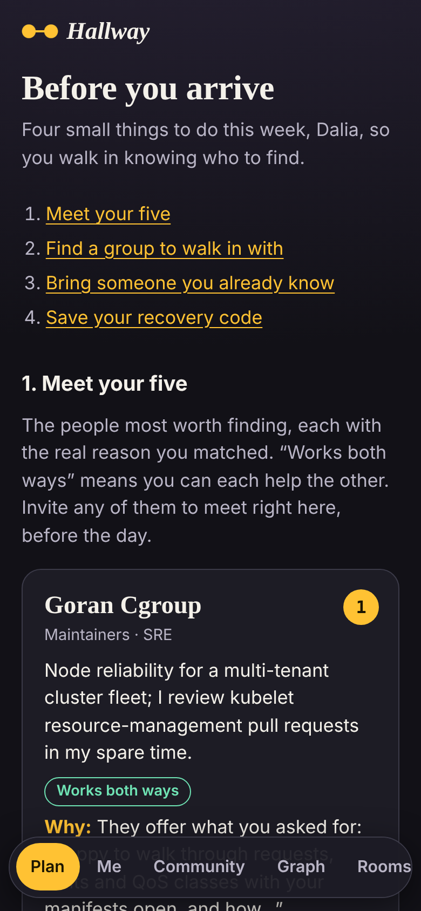
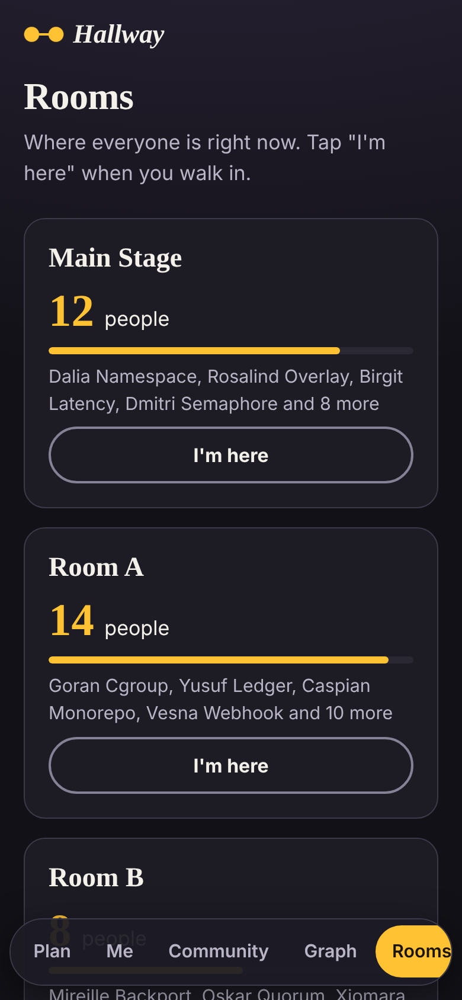
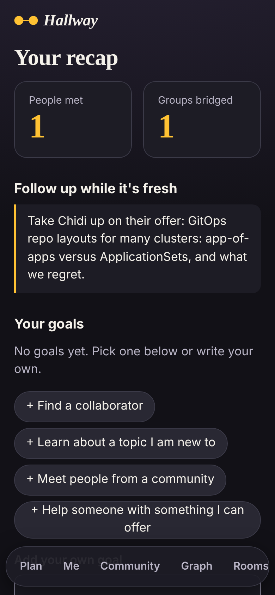
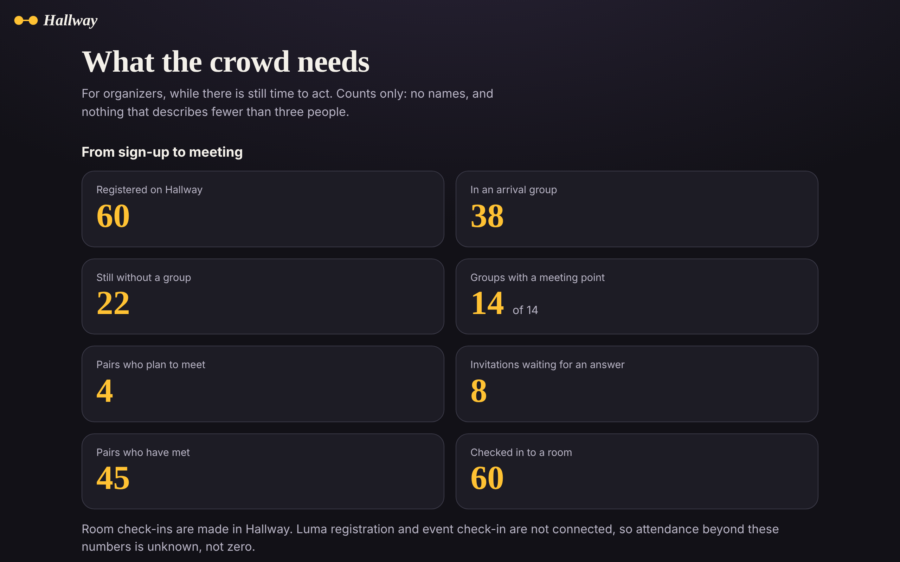
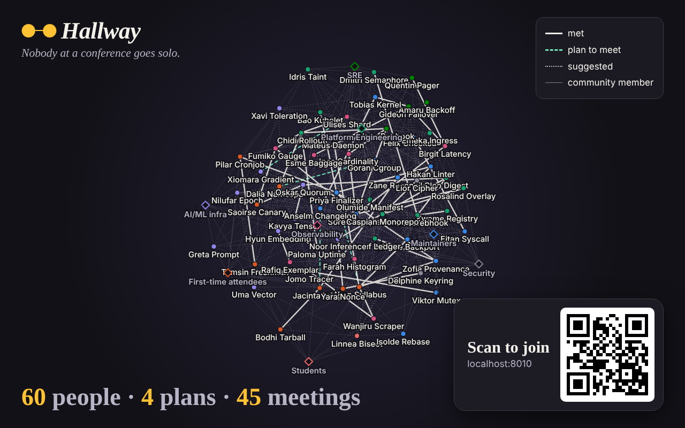

# Hallway

**Nobody at a conference goes solo.**

Hallway helps communities and attendees prepare to arrive together. RSVP on Luma,
share your asks and offers, and find people to meet before the conference. Our
product direction is an accepted arrival group and meeting plan, with a graph
that helps those relationships grow during and after the event.

**Start with the [working plan](docs/WORKING_PLAN.md).** It consolidates community
signup, Luma integration, accessibility, graph behavior, and build priorities.
Planned features are distinguished from the existing implementation below.

Built in one day at the Cloud Native Hackathon, Salt Lake City, 9 November 2026.

## Before, during, after

| When | What you get | Status |
|---|---|---|
| **Before** | Register in a minute, with no account. Edit what you need and offer at any time. | Built |
| **Before** | Your five: the people to meet, each with a true reason and an icebreaker, and a mark when a match works both ways. | Built |
| **Before** | Send your link to someone you already know, and you are connected before day one. | Built |
| **Before** | A recovery code, so the profile you made at home opens on your phone at the venue. | Built |
| **Before** | A suggested arrival group you can accept, decline or leave, with an agreed place and time to meet. | Built |
| **Before** | If your group falls apart, you are told, and you can ask for another. Nobody is moved for you. | Built |
| **Before** | Invite someone to meet. Private until they accept. | Built |
| **Before** | Join a community from its invitation page, separately from the Luma RSVP. | Built |
| **Before** | For organizers: a board of what people ask for against what they offer, in counts only (`/crowd`). | Built |
| **Before** | Your own goals for the conference, which only you can see and tick. | Built |
| **Before** | Luma registration and check-in kept in sync. | Planned (needs Luma API access) |
| **During** | Scan a QR code to connect. A live graph on the venue screen. A room map. | Built |
| **After** | A recap of who you met, your goals, and what to follow up on. | Built |

The current build order is in [`docs/WORKING_PLAN.md`](docs/WORKING_PLAN.md).
[`docs/PRE_CONFERENCE.md`](docs/PRE_CONFERENCE.md) preserves the earlier v4 design.

## What it looks like

All data in these pictures is fictional seed data, running on a laptop.

| Before you arrive | The room map | Your recap |
|---|---|---|
|  |  |  |

The organizer board, in counts only:



The live graph on the venue screen:



## How it works

```
 phone / laptop / venue screen
            |  https (cloudflared quick tunnel)
            v
 +---------------------------+        +--------------------------+
 |  hallway  (one image)     |  -->   |  Elasticsearch           |
 |  FastAPI: /api/*          |        |  attendees, edges,       |
 |  React app: everything    |        |  checkins. The only      |
 |  else                     |        |  datastore.              |
 +---------------------------+        +--------------------------+
            |  OTLP (traces, metrics, logs)        ^
            v                                      |
          Dash0                     hallway-matcher (CronJob, same image)
```

Everything runs on a Kubernetes cluster that Radar is connected to. It is one Helm release.

| Sponsor tool | What it does in Hallway |
| --- | --- |
| **Elasticsearch** | The only datastore, and the matchmaker. One hybrid query with reciprocal rank fusion crosses *my asks* with *their offers*, *my offers* with *their asks*, similar work, shared tags and shared groups. Each signal runs as keyword search and, when an inference endpoint is configured, as semantic search too. Named queries tell us which signal matched, so the reason shown to the user is true and not made up by a language model. See [`api/hallway/matching.py`](api/hallway/matching.py). |
| **Dash0** | The API runs under OpenTelemetry auto-instrumentation and adds its own spans (`match.query`, `match.icebreaker`, `graph.bfs`, `matcher.run`) and metrics (connections made, room occupancy). The browser can send real user monitoring data once its token is set. The room map and the organizer board are drawn from the same numbers the dashboard shows. The dashboard, two check rules and an SLO are kept as code in [`deploy/dash0/`](deploy/dash0/); see [`docs/DASH0.md`](docs/DASH0.md). Dash0's own data showed us the matcher failing on a rate limit: [`docs/investigations/2026-11-09-1558-elser-rate-limit-dash0.md`](docs/investigations/2026-11-09-1558-elser-rate-limit-dash0.md). |
| **Radar** | The cluster view during the whole build, and the investigation tool when a pod is killed for using too much memory: Radar's AI named the cause in 87 seconds. See [`docs/investigations/2026-11-09-1518-oom-radar.md`](docs/investigations/2026-11-09-1518-oom-radar.md). |
| **Gitar** | Reviews every pull request against our own rules in [`docs/GITAR_RULES.md`](docs/GITAR_RULES.md), and diagnoses CI failures. When a PR forgot to regenerate the browser types, Gitar named the rule and pushed the fix in two minutes: [`docs/investigations/2026-11-09-1347-gitar-schema-drift.md`](docs/investigations/2026-11-09-1347-gitar-schema-drift.md). |

## Run it

### Option 1: on your laptop

You need Python 3.12+, Node 20+, and an Elasticsearch 9 URL (Elastic Cloud serverless works; so does a local one).

```bash
cp .env.example .env
```

Fill in `ES_URL` and `ES_API_KEY`. Everything else is optional. Then:

```bash
python -m venv .venv && . .venv/bin/activate && pip install -e "./api[dev]"
```

```bash
(cd web && npm ci)
```

```bash
make dev
```

Open http://localhost:5173. To fill it with 60 made-up attendees:

```bash
make seed
```

### Option 2: on a Kubernetes cluster

You need `kubectl` pointed at the cluster, `helm`, and Docker.

```bash
make image
```

```bash
make secrets
```

```bash
make deploy
```

```bash
make url
```

`make url` prints a public https address. Share it or turn it into a QR code. No ingress, DNS or account is needed.
If you cannot log in to the GitHub container registry, `make image-ttl` pushes to a free anonymous registry instead and prints the deploy command.

Check a deployed demo without changing its data (uses the Python API dependencies):

```bash
make smoke API="$URL"
```

Set `URL` to the demo base URL, or use `make smoke` for `http://localhost:8000`
with the built frontend served by the API. The check uses only GET requests:
Join (`/`), Plan (`/plan`), Graph (`/graph`), a JavaScript asset referenced by
Join, and `/healthz` with `ok: true` and Elasticsearch `es: "green"`.
It checks the HTML app shell and asset delivery, not browser execution or attendee
flows. Each request has a 10-second timeout; redirects, failed routes, invalid
content and unavailable Elasticsearch exit nonzero with the failing check.
No credentials or fixed tunnel address are needed. Run `make test-smoke` to test
the checker against a local fixture without a deployed app or Elasticsearch.

### Option 3: just the tests

```bash
make test
```

```bash
make lint
```

The API tests run against a real Elasticsearch at `ES_URL` and skip themselves if it is not reachable.

## Where things are

| Path | What is in it |
| --- | --- |
| `api/hallway/` | The API. Start with `matching.py`, then `routes/`. |
| `api/tests/` | Tests for matching, graph paths, and every endpoint. |
| `web/src/` | The React app. One file per page in `pages/`. |
| `deploy/chart/hallway/` | The Helm chart: API, matcher CronJob, tunnel. |
| `seed/` | 60 fictional attendees and a script that loads them through the API. |
| `docs/API.md` | The contract between the API and the web app. |
| `docs/PRE_CONFERENCE.md` | Why the product leads with the week before, and the features that make it real. |
| `docs/RUNBOOK.md` | Who does what today, in order, with a troubleshooting table. |
| `docs/REVIEW.md` | What was wrong with our first plan and how we fixed it. |
| `docs/DEMO.md` | The three-minute demo script and the planned incidents. |
| `docs/GITAR_RULES.md` | The review rules we gave Gitar. |
| `docs/DASH0.md` | What we send to Dash0, and the dashboard, check rules and SLO kept as code in `deploy/dash0/`. |
| `docs/investigations/` | Write-ups of real incidents found with Radar, Dash0 and Gitar. |

## Privacy

- There are no accounts, emails or passwords. A profile is a name and what you choose to write.
- Your session is a random secret in an HttpOnly cookie. Your public id is safe to put in a QR code.
- You can leave the public graph at any time. People who are off the graph are never shown on it.
- All data in this repository and in the demo is fictional.

## AI assistance disclosure

We used AI tools to build this, as the hackathon rules allow.

- **Claude Code** helped review our plan and wrote a large part of the first version of the API, the web app, the Helm chart, the tests and these docs.
- **Gitar** reviews our pull requests and suggests fixes for CI failures.
- **Dash0** (its query API, driven from Claude Code) and **Radar's AI investigation** were used on the incidents in `docs/investigations/`.
- The app itself calls a language model for one thing only: an optional one-line icebreaker. Matching and the reasons shown never depend on it.

Every team member has read the code they present and can explain it. `docs/REVIEW.md` records the design decisions and why we made them.
